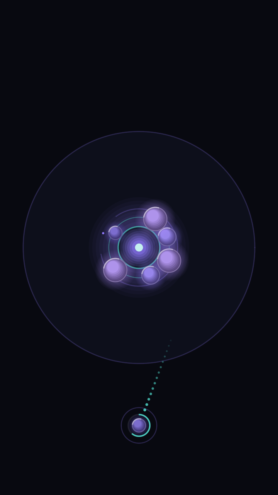

# ORBIT

A premium minimalist 2D physics merge puzzle (Godot 4, GDScript). See
[PROJECT_SPEC.md](PROJECT_SPEC.md), [ROADMAP.md](ROADMAP.md) and
[DEVELOPMENT_LOG.md](DEVELOPMENT_LOG.md).



## Run it
1. Install **Godot 4.5.x (standard, not .NET)** from https://godotengine.org/download
2. Open Godot → **Import** → select this folder's `project.godot` → **Import & Edit**.
3. Press **F5** (or the ▶ Play button, top right).
4. Click-and-drag anywhere, pull back, release. Press **R** to restart.

## Run the tests
```bash
godot --headless -s res://tests/run_tests.gd
```
(Use the full path to your Godot executable if `godot` isn't on your PATH.
On macOS: `/Applications/Godot.app/Contents/MacOS/Godot`.)

## Tweak the gameplay
Open `resources/config/default_config.tres` in the Godot Inspector.
