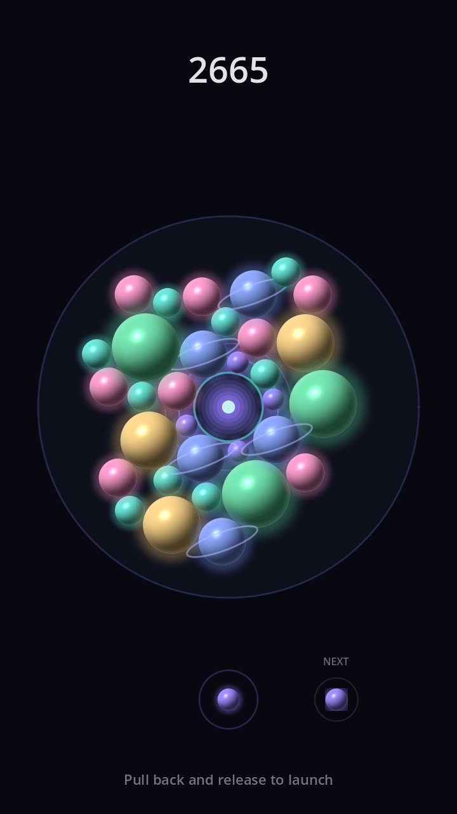

# ORBIT

A premium minimalist 2D physics merge puzzle (Godot 4, GDScript). See
[PROJECT_SPEC.md](PROJECT_SPEC.md), [ROADMAP.md](ROADMAP.md) and
[DEVELOPMENT_LOG.md](DEVELOPMENT_LOG.md).



## Run it
1. Install **Godot 4.5.x (standard, not .NET)** from https://godotengine.org/download
2. Open Godot → **Import** → select this folder's `project.godot` → **Import & Edit**.
3. Press **F5** (or the ▶ Play button, top right).
4. Click-and-drag anywhere, pull back, release. Merge equal planets; don't let
   planets come to rest outside the ring. Press **R** to restart any time.

## Run the tests
```bash
godot --headless -s res://tests/run_tests.gd
```
(Use the full path to your Godot executable if `godot` isn't on your PATH.
On macOS: `/Applications/Godot.app/Contents/MacOS/Godot`.)

## Tweak the gameplay
Open `resources/config/default_config.tres` in the Godot Inspector.

## Test on your phone

The project already contains export presets for Android and iOS
(`export_presets.cfg`). Before publishing, change the placeholder app ID
`com.example.orbit` to your own (e.g. `com.yourname.orbit`) in
**Project → Export**.

### Android (Windows, macOS or Linux)
1. **Export templates:** in Godot, **Editor → Manage Export Templates → Download and Install**.
2. **Java:** install OpenJDK 17 (e.g. from adoptium.net).
3. **Android SDK:** install **Android Studio** (developer.android.com/studio), open it
   once, and let it install the SDK. Then, in its SDK Manager, also install
   *Android SDK Build-Tools* and *Android SDK Platform-Tools*.
4. In Godot: **Editor → Editor Settings → Export → Android**, set
   *Java SDK Path* (the JDK folder) and *Android SDK Path* (shown in Android
   Studio's SDK Manager). Godot creates a debug signing key automatically.
5. On the phone: **Settings → About phone → tap "Build number" 7 times** to unlock
   Developer options, then enable **USB debugging**. Connect the phone by USB.
6. In Godot, the **Android icon** appears in the top-right toolbar: click it
   to install and launch ORBIT on the phone (one-click deploy).
   Alternative: **Project → Export → Android → Export Project** creates an `.apk`
   you can copy to the phone and open (allow "install unknown apps").

### iPhone (requires a Mac)
1. Install **Xcode** from the Mac App Store and sign in with your Apple ID in
   Xcode → Settings → Accounts (a free account works for testing on your own
   phone; apps then expire after 7 days).
2. Install export templates (as above).
3. In **Project → Export → iOS**, set *App Store Team ID* (shown in Xcode's
   account settings) and a unique *Bundle Identifier*.
4. **Export Project** → open the generated `.xcodeproj` in Xcode → select your
   iPhone → **Run**. On the phone, trust the developer profile in
   Settings → General → VPN & Device Management.

### What to check on a real phone
Feel of the launch, sound volume/character, vibration strength, FPS with a
full board, notch/home-indicator spacing, pausing when switching apps.
